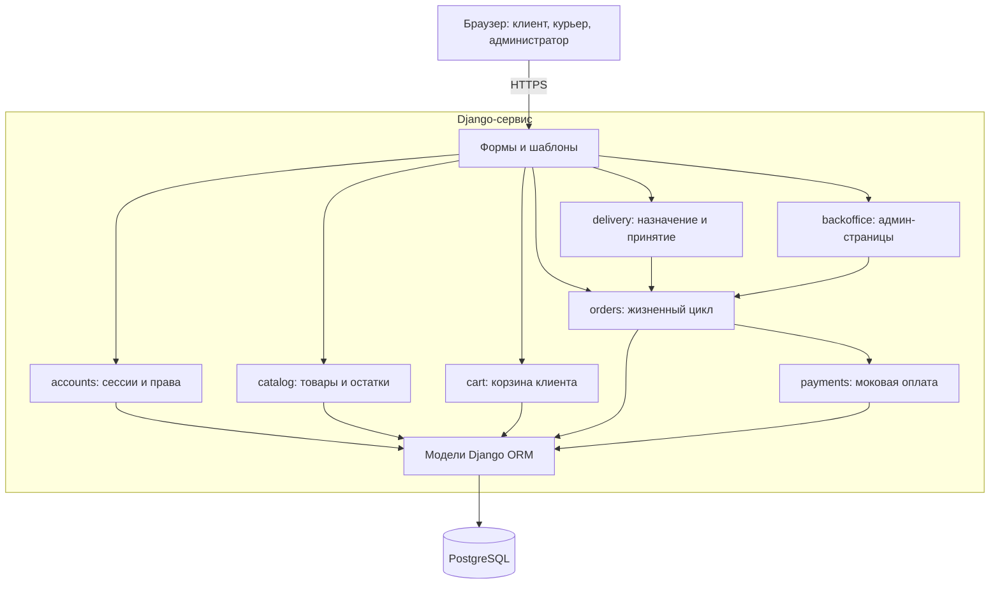
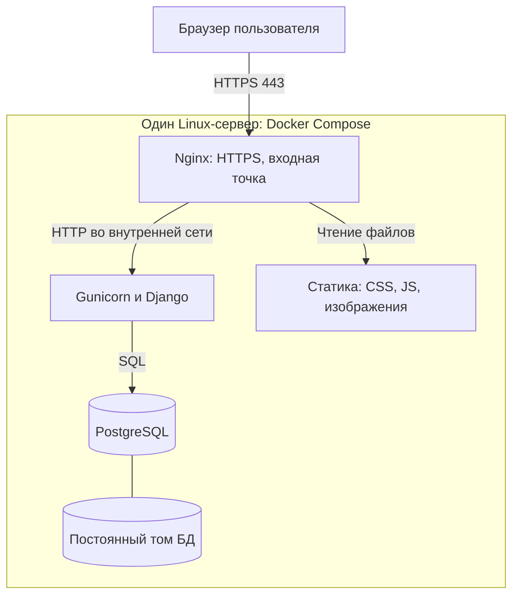
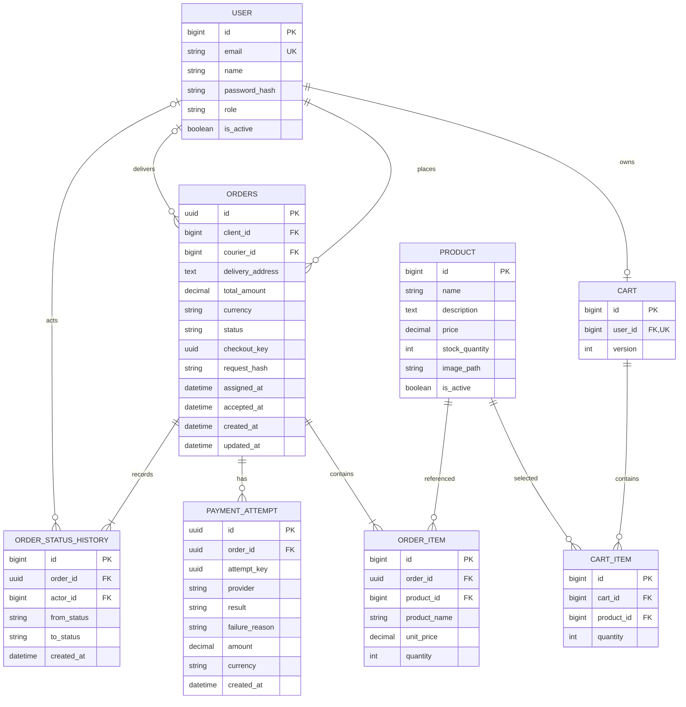
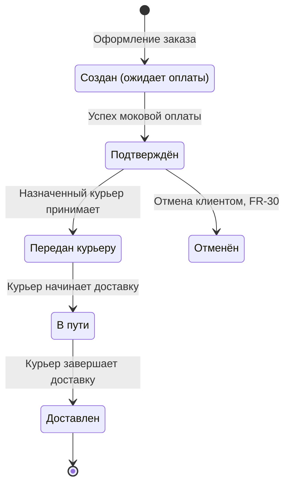
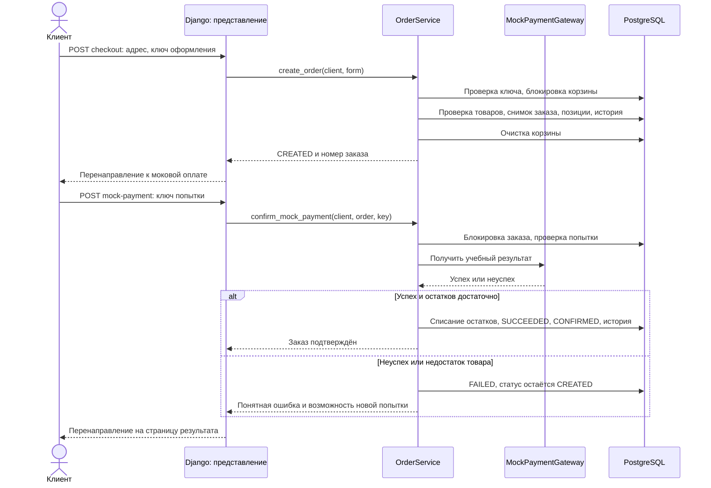
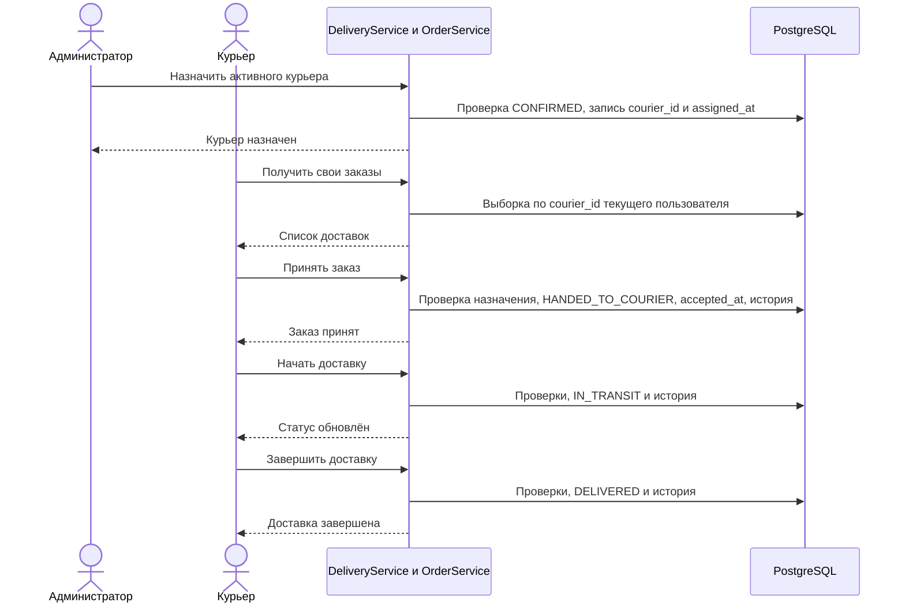

# Этап 3. Технологический стек и архитектура проекта «Сервис доставки товаров»

## 1. Назначение этапа и исходные данные

Этап 1 определил идею проекта, роли пользователей и сценарии работы. Этап 2 зафиксировал функциональные требования FR-01…FR-45, нефункциональные требования NFR-01…NFR-11 и объём MVP.

**Требования этапов 1–2 принимаются на этом этапе без изменений.** Этап 3 не пересматривает их, а отвечает на вопросы: на чём делать, как разделить систему на части, как хранить данные и как обеспечить переходы заказа между состояниями.

Требования этапов 1–2, на которые опирается документ:

- три роли — клиент, курьер, администратор (§1.5, §2.1 этапов 1–2);
- жизненный цикл заказа: «Создан (ожидает оплаты)» → «Подтверждён» → «Передан курьеру» → «В пути» → «Доставлен», дополнительно переход «Подтверждён» → «Отменён» (§2.2, FR-29, FR-30);
- объём MVP и список вынесенного за его границы (§3 этапов 1–2).

Основное решение этапа: **модульный монолит на Python и Django, серверный веб-интерфейс, PostgreSQL**. Оплата выполняется моковым компонентом и остаётся эмулируемой: реальная платёжная интеграция не планируется.

---

## 2. Границы и допущения

### 2.1. Объём MVP и следующей версии

| Возможность | MVP | Следующая функциональная версия |
|---|---|---|
| Регистрация, вход, выход и роли (FR-01–06) | Реализуется | Сохраняется |
| Каталог и карточка товара (FR-07–09) | Реализуется | Сохраняется |
| Поиск по каталогу (FR-10) | Не реализуется | Реализуется |
| Корзина и расчёт стоимости (FR-11–15) | Реализуется | Сохраняется |
| Оформление заказа, адрес, снимок состава и цены (FR-16–20) | Реализуется | Сохраняется |
| Начальный статус «Создан (ожидает оплаты)» (FR-26) | Реализуется | Сохраняется |
| Реальная онлайн-оплата сторонним сервисом (FR-21–25) | Не реализуется и не планируется | — |
| Моковая оплата | Имитация успешной и неуспешной операции вместо FR-21–25 | Сохраняется как итоговое решение |
| Собственные заказы и статусы (FR-27–29) | Реализуется | Сохраняется |
| Отмена заказа клиентом (FR-30) | Не реализуется | Реализуется; ветка `CANCELLED` отмечена на диаграмме состояний |
| Работа курьера (FR-31–37) | Реализуется полностью | Сохраняется |
| Работа администратора с заказами (FR-41–43) | Просмотр заказов и назначение курьера | Сохраняется |
| Управление каталогом через интерфейс (FR-38–40) | Не реализуется; каталог наполняется служебной командой сидинга | Реализуется, включая сценарий 3 этапов 1–2 |
| Список и блокировка пользователей (FR-44–45) | Не реализуются | Реализуются |
| Нормативы производительности и полная проверка браузеров (NFR-01, NFR-02, NFR-11) | Не входят в приёмку MVP | После уточнения условий |

Таким образом, все 45 функциональных требований учтены: 33 реализуются в MVP, семь отнесены к следующей версии, пять (FR-21–25) закрыты эмуляцией оплаты. Полная трассировка — в разделе 10.

### 2.2. Архитектурные допущения

Требования оставляют часть решений открытыми. Принятые решения сведены ниже; каждое отмечает, какое место требований оно конкретизирует.

| № | Принятое решение | Обоснование |
|---|---|---|
| A-01 | Один каталог и один склад, без отдельных продавцов | Такие участники не описаны в требованиях |
| A-02 | В MVP выбирается моковая оплата, а не «оплата при получении» | Финальный файл этапа 2 допускает её как вариант упрощения. Дополнительно фиксируется: **выбор способа оплаты из §2.1 в MVP не реализуется** — способ один, и он относится к FR-21–25 |
| A-03 | `CREATED` показывается как «Создан (ожидает оплаты)». Успешная моковая операция переводит заказ в `CONFIRMED` | Сохраняет статусы FR-24 и FR-26 без добавления «Оплаты при получении» как статуса доставки |
| A-04 | Назначение курьера сохраняет статус «Подтверждён». Принятие назначенным курьером переводит заказ в «Передан курьеру» | Разделяет действия администратора и курьера из сценария 2 и FR-34 |
| A-05 | Остаток уменьшается при успешном подтверждении заказа, а не при добавлении в корзину | Корзина не резервирует товары. Для моковой операции подтверждение и списание выполняются одной транзакцией |
| A-06 | В MVP сумма заказа равна сумме его позиций, отдельный тариф доставки не вводится. Валюта одна, RUB | В требованиях нет правил расчёта тарифа и нескольких валют; соответствует FR-14 и FR-15 |
| A-07 | Один пользователь имеет одну бизнес-роль: клиент, курьер или администратор | Достаточно для трёх интерфейсов, описанных в §1.5 этапов 1–2 |
| A-08 | Публичная регистрация создаёт только клиента. Курьеров и администраторов создаёт служебная команда | Пользователь не должен самостоятельно назначать себе привилегии. Управление учётными записями — это FR-44–45, вынесенные за границы MVP |
| A-09 | Адрес хранится текстовым снимком в заказе, без геокодирования и адресной книги | Достаточно для FR-17 и FR-32 |
| A-10 | **Администратор не устанавливает статус заказа вручную.** Он только назначает курьера; все остальные переходы выполняются сервисами по бизнес-правилам | §2.1 этапов 1–2 перечисляет у администратора «изменять состояние заказа». Это сужение осознанное: произвольная смена статуса обошла бы проверки остатков, прав и истории. Возможность администратора реализуется через назначение курьера (FR-43) и просмотр (FR-41, FR-42) |

---

## 3. Технологический стек

| Уровень | Технология | Назначение и причина выбора |
|---|---|---|
| Язык сервера | Python | Один основной язык для бизнес-логики, моделей, форм и тестов |
| Веб-фреймворк | Django | Маршрутизация, HTML-шаблоны, формы, ORM, миграции и аутентификация в одном фреймворке |
| Интерфейс | Django Templates, HTML, Bootstrap | Отдельные страницы клиента, курьера и администратора; базовая адаптация под телефон |
| Динамика интерфейса | JavaScript | Необязательное улучшение пересчёта и сообщений. Основные действия работают через HTML-формы |
| База данных | PostgreSQL | Связанные данные, ограничения целостности, транзакции и блокировка строк |
| Драйвер БД | psycopg | Подключение Django к PostgreSQL |
| Входной веб-сервер | Nginx | HTTPS, проксирование запросов и выдача статических файлов |
| Прикладной сервер | Gunicorn (WSGI) | Запускает Django-приложение, управляет рабочими процессами и обеспечивает параллельную обработку HTTP-запросов |
| Воспроизводимое окружение | Docker и Docker Compose | Контейнеры приложения, БД и Nginx с общей конфигурацией запуска |
| Проверки | pytest, pytest-django | Проверка бизнес-правил, HTTP-доступа, транзакций и качества Python-кода |

---

## 4. Архитектура

### 4.1. Модульный монолит

Приложение представляет собой один развёртываемый сервис и одну базу данных. Внутри сервиса код разделён на предметные модули. Модуль не является отдельным процессом или микросервисом.

Три уровня ответственности:

1. **Представление:** URL, middleware, представления Django, формы и HTML-шаблоны. Принимает запрос и возвращает ответ.
2. **Прикладная логика:** сервисные функции оформления, подтверждения, назначения и доставки. Проверяет права, текущее состояние и бизнес-правила.
3. **Хранение:** модели Django ORM, ограничения PostgreSQL и миграции. Обеспечивает устойчивое хранение.

Для чтения используются функции выборки, например `list_client_orders`. Для изменения данных — именованные команды, например `create_order` и `accept_delivery`. Универсальный метод «поставить любой статус» не предоставляется: это следствие допущения A-10.

### 4.2. Модули и закрываемые требования

| Модуль | Ответственность | Закрываемые требования | Основные операции |
|---|---|---|---|
| `accounts` | Пользователи, роли и сессии | FR-01–06, NFR-03, NFR-04 | Регистрация клиента, вход, выход, проверка роли |
| `catalog` | Отображение товаров и остатков | FR-07–09 | Список, карточка, служебная загрузка каталога |
| `cart` | Постоянная корзина клиента | FR-11–15 | Добавить, изменить количество, удалить, рассчитать сумму |
| `orders` | Состав, цены, состояния и история заказа | FR-16–20, FR-24, FR-26–29 | Создать заказ, подтвердить, прочитать допустимые заказы |
| `delivery` | Рабочее место курьера и назначение | FR-31–37 | Назначить, принять, начать, завершить доставку |
| `payments` | Эмуляция результата оплаты | FR-21–25 (эмуляция) | `MockPaymentGateway` и модель попытки оплаты |
| `backoffice` | Минимальные административные страницы | FR-41–43 | Все заказы, карточка заказа, форма назначения курьера |

### 4.3. Диаграмма компонентов

На диаграмме показаны все семь модулей из таблицы 4.2, включая `backoffice`, и `catalog` с `cart` раздельно, как и в списке модулей.

Все изменения заказа, включая действия администратора из `backoffice`, проходят через сервисы `orders`. Модуль `delivery` вызывает эти сервисы, а не записывает статусы самостоятельно.

---

## 5. Развёртывание

Моковый платёжный компонент работает внутри Django. Внешнего провайдера в развёртывании MVP нет.

---

## 6. Модель данных

### 6.1. Сущности и их назначение

Поля сущностей приведены на ER-диаграмме в 6.2; здесь указано назначение и закрываемые требования.

| Сущность | Назначение | Требования |
|---|---|---|
| `User` | Имя, уникальная почта, хеш пароля и бизнес-роль | FR-01–03, FR-06, NFR-03 |
| `Product` | Название, описание, цена, остаток, изображение, признак активности | FR-07, FR-08 |
| `Cart` | Одна постоянная корзина на клиента | FR-11–15 |
| `CartItem` | Товар и количество в корзине | FR-11–13 |
| `Order` | Клиент, адрес, сумма, статус и назначенный курьер | FR-16–18, FR-26, FR-31, FR-32 |
| `OrderItem` | Неизменяемый снимок позиции оформленного заказа | FR-19, FR-20, FR-33 |
| `PaymentAttempt` | Попытка моковой оплаты и её результат | FR-23, FR-25 |
| `OrderStatusHistory` | История создания заказа и переходов его статуса | FR-29, объяснимость процесса |

Таблицы попыток оплаты и истории статусов — не «дополнение ради дополнения»: FR-23 требует сохранять результат платежа, FR-25 — позволять повторную попытку, FR-29 — показывать текущий статус, а история делает переходы объяснимыми при разборе.

### 6.2. ER-диаграмма

Здесь `ORDERS` соответствует модели `Order`. `courier_id`, `assigned_at` и `accepted_at` могут быть пустыми. `actor_id` в истории допускает `NULL` для системного перехода, например подтверждения после оплаты. Для первой записи `from_status = NULL`, `to_status = CREATED`.

Каждый заказ создаётся с хотя бы одной позицией и одной записью истории. Это обеспечивает сервис оформления внутри транзакции: обычный внешний ключ сам по себе не гарантирует наличие дочерней строки.

Схема показывает предметные таблицы. Стандартные таблицы сессий, миграций и разрешений Django опущены. `User` реализуется как собственная модель на основе `AbstractUser` с входом по email; логическое поле `password_hash` соответствует стандартному полю Django `password`, в котором хранится кодированный хеш. Модель пользователя задаётся до первой миграции.

### 6.3. Идемпотентность и целостность

Часть полей на диаграмме существует не ради данных, а ради защиты от повторных операций — этого требует NFR-07: информация об уже созданном заказе не должна теряться или дублироваться при обновлении и повторной отправке страницы.

| Поле | Назначение |
|---|---|
| `Order.checkout_key` | Ключ оформления. Повторная отправка формы с тем же ключом возвращает уже созданный заказ, а не создаёт второй |
| `Order.request_hash` | Отпечаток содержимого запроса оформления: тот же ключ с другим содержимым распознаётся как конфликт |
| `Cart.version` | Версия корзины: защищает расчёт от одновременного изменения в двух вкладках |
| `PaymentAttempt.attempt_key` | Ключ попытки оплаты: повторное нажатие не проводит вторую операцию |

Остатки списываются и статус меняется в одной транзакции с блокировкой строки заказа и строк товаров, поэтому одновременные попытки подтвердить один заказ не приведут к двойному списанию.

---

## 7. Доступ и интерфейсы

### 7.1. Матрица доступа MVP

| Действие | Гость | Клиент | Курьер | Администратор |
|---|---|---|---|---|
| Каталог и карточка товара | Да | Да | Да | Да |
| Регистрация клиента и вход | Да | Только выход из текущей сессии | Только выход | Только выход |
| Изменение корзины и оформление | Нет | Своя корзина | Нет | Нет |
| Моковая оплата | Нет | Только свой созданный заказ | Нет | Нет |
| Просмотр заказа | Нет | Только своего | Только назначенного ему | Любого |
| Назначение курьера | Нет | Нет | Нет | Подтверждённый заказ |
| Принятие и выполнение доставки | Нет | Нет | Только своей | Нет |
| Изменение статуса вручную | Нет | Нет | Нет | Нет (A-10) |
| Управление каталогом и пользователями через веб | Нет | Нет | Нет | Вне MVP |

Матрица закрывает NFR-04 (административные функции только для администратора), NFR-05 (клиент не видит чужие заказы) и NFR-06 (у курьера нет административного доступа). Проверка выполняется на уровне представлений и сервисов, а не только скрытием элементов интерфейса.

### 7.2. Группы маршрутов

Полный перечень путей относится к этапу реализации; здесь указаны группы и требования, которым они служат.

| Группа | Назначение | Требования |
|---|---|---|
| `/auth/` | Регистрация, вход, выход | FR-01–05 |
| `/products/` | Каталог и карточка товара | FR-07–09 |
| `/cart/` | Просмотр корзины, добавление, изменение количества, удаление | FR-11–13 |
| `/checkout/` | Форма адреса и создание заказа | FR-16–18 |
| `/orders/` | Свои заказы, подробности, текущий статус | FR-27–29 |
| `/orders/<uuid>/mock-payment/` | Явно обозначенная страница эмулируемой оплаты | FR-21–25 (эмуляция) |
| `/courier/orders/` | Назначенные доставки, принятие, начало, завершение | FR-31–36 |
| `/operator/orders/` | Все заказы, карточка заказа, назначение курьера | FR-41–43 |
| `/health/` | Проверка работы процесса и готовности БД | Эксплуатация |

Это контракт серверных страниц и команд, а не отдельный публичный REST API.

---

## 8. Жизненный цикл заказа

### 8.1. Диаграмма состояний

Основной путь соответствует жизненному циклу из §2.2 этапов 1–2. Переход в `CANCELLED` описан там же как дополнительный и относится к FR-30, но **в MVP он не реализуется** — ветка показана для полноты схемы.

Неуспешная моковая оплата сохраняет статус `CREATED` и записывается как неуспешная попытка. Новый статус заказа «Ошибка оплаты» не добавляется.

### 8.2. Переходы и условия

| Команда | Исходное состояние | Результат | Условия |
|---|---|---|---|
| Создать заказ | Заказа нет | `CREATED` | Клиент авторизован, корзина непустая, адрес корректен, товары доступны |
| Подтвердить моковую оплату | `CREATED` | `CONFIRMED` | Заказ принадлежит клиенту, мок вернул успех, остатков достаточно |
| Зафиксировать неуспех мока | `CREATED` | `CREATED` | Попытка записывается, остатки не списываются |
| Назначить курьера | `CONFIRMED` | `CONFIRMED` | Администратор, выбран активный курьер |
| Переназначить курьера | `CONFIRMED` | `CONFIRMED` | Заказ ещё не принят курьером |
| Принять заказ | `CONFIRMED` | `HANDED_TO_COURIER` | Выполняет назначенный курьер, `accepted_at` заполняется |
| Начать доставку | `HANDED_TO_COURIER` | `IN_TRANSIT` | Выполняет назначенный курьер |
| Завершить доставку | `IN_TRANSIT` | `DELIVERED` | Выполняет назначенный курьер |
| Отменить заказ | `CONFIRMED` | `CANCELLED` | FR-30; **вне MVP** |

Для назначения сохраняются `courier_id` и `assigned_at`, для принятия — `accepted_at`. Каждая смена статуса добавляет строку истории в той же транзакции. Повтор назначения тому же курьеру не создаёт новое назначение. После принятия переназначение в MVP запрещено.

---

## 9. Ключевые сценарии

### 9.1. Оформление и подтверждение заказа

### 9.2. Назначение и выполнение доставки

Первая сцена соответствует сценарию 1 и FR-16–26, вторая — сценарию 2 и FR-31–36. Сценарий 3 этапов 1–2 (управление товаром администратором) в MVP не реализуется и отнесён к FR-38–40 следующей версии.

---

## 10. Соответствие требованиям

### 10.1. Покрытие функциональных требований

| Требования | Содержание | Где реализуется |
|---|---|---|
| FR-01, FR-02, FR-03, FR-04, FR-05, FR-06 | Регистрация по имени, почте и паролю; уникальная почта; вход; выход; разграничение доступа по роли | Модуль `accounts`, группа маршрутов `/auth/`, матрица доступа 7.1 |
| FR-07, FR-08, FR-09 | Список товаров; карточка с названием, описанием, ценой, изображением и наличием; отдельная страница товара | Модуль `catalog`, сущность `Product`, группа `/products/` |
| FR-10 | Поиск товара по названию | **Вне MVP**, следующая версия |
| FR-11, FR-12, FR-13, FR-14, FR-15 | Добавление, удаление, изменение количества; автоматический расчёт и показ итоговой стоимости | Модуль `cart`, сущности `Cart` и `CartItem`, группа `/cart/`, допущение A-06 |
| FR-16, FR-17, FR-18, FR-19, FR-20 | Оформление заказа авторизованным клиентом; адрес доставки; уникальный номер; сохранение состава и стоимости | Модуль `orders`, сущности `Order` и `OrderItem`, группа `/checkout/`, сценарий 9.1 |
| FR-21, FR-22, FR-23, FR-24, FR-25 | Оплата онлайн сторонним сервисом; передача данных платежа; сохранение результата; успех переводит в «Подтверждён»; ошибка и повтор | **Реализуются в виде эмуляции**: модуль `payments`, сущность `PaymentAttempt`, страница `/orders/<uuid>/mock-payment/`. Контур повторён полностью — данные платежа, результат, повтор при ошибке, переход в «Подтверждён». Реальный провайдер не планируется |
| FR-26 | Начальный статус «Создан (ожидает оплаты)» | Модуль `orders`, допущение A-03, диаграмма 8.1 |
| FR-27, FR-28, FR-29 | Список своих заказов; подробности; текущий статус | Модуль `orders`, сущность `OrderStatusHistory`, группа `/orders/` |
| FR-30 | Отмена заказа до этапа «Передан курьеру» | **Вне MVP**. Ветка `CANCELLED` отмечена на диаграмме 8.1 и в таблице 8.2 |
| FR-31, FR-32, FR-33 | Назначенные заказы; адрес доставки; состав заказа | Модуль `delivery`, поля `Order.courier_id` и `Order.delivery_address`, `OrderItem` |
| FR-34, FR-35, FR-36 | Принятие заказа; статус «В пути»; статус «Доставлен» | Модуль `delivery`, допущение A-04, группа `/courier/orders/`, сценарий 9.2 |
| FR-37 | Курьер не может менять чужие заказы | Матрица доступа 7.1, проверка в сервисах `orders` |
| FR-38, FR-39, FR-40 | Создание, редактирование, скрытие товара администратором | **Вне MVP**. Каталог наполняется служебной командой сидинга; сценарий 3 относится к следующей версии |
| FR-41, FR-42, FR-43 | Список всех заказов; подробности любого заказа; назначение курьера | Модуль `backoffice`, группа `/operator/orders/` |
| FR-44, FR-45 | Список пользователей; блокировка учётной записи | **Вне MVP**, следующая версия |

### 10.2. Соответствие нефункциональным требованиям

| Требования | Содержание | Как обеспечивается |
|---|---|---|
| NFR-01, NFR-02 | Загрузка страниц ≤ 3 с; поиск ≤ 2 с | В приёмку MVP не входят. Поиск (FR-10) в MVP отсутствует; архитектура не препятствует: индексы PostgreSQL и кэширование добавляются вместе с ним |
| NFR-03 | Пароли не хранятся в открытом виде | Поле `password` модели `User` на основе `AbstractUser` хранит кодированный хеш; открытый пароль нигде не сохраняется |
| NFR-04 | Административные функции только для администратора | Матрица доступа 7.1; роль проверяется в представлениях и сервисах, а не только в интерфейсе |
| NFR-05 | Клиент не имеет доступа к заказам других клиентов | Все выборки заказов клиента ограничены его `client_id`; проверка повторяется в сервисе перед изменением |
| NFR-06 | Курьер не имеет административного доступа | Курьеру доступны только маршруты `/courier/orders/`; административные представления проверяют роль |
| NFR-07 | Информация о созданном заказе не теряется при обновлении страницы | Заказ хранится на сервере в PostgreSQL, а не в сессии браузера. Повторная отправка защищена ключами оформления и попытки оплаты (6.3) |
| NFR-08 | Ошибки обрабатываются и показываются понятно | Сервисы возвращают прикладные ошибки, представления показывают их пользователю; неуспешная оплата не приводит к потере заказа и допускает повтор (сценарий 9.1) |
| NFR-09 | Интерфейс понятен без специального обучения | Стандартные HTML-формы и страницы Bootstrap с подписями полей и явными действиями; отдельные интерфейсы под каждую роль |
| NFR-10 | Корректное отображение на компьютере и мобильном | Адаптивная сетка Bootstrap; основные действия выполняются HTML-формами без обязательного JavaScript |
| NFR-11 | Поддержка актуальных версий браузеров | В приёмку MVP не входит; полная проверка — после уточнения условий |

---

## 11. Итог

Все 45 функциональных требований этапов 1–2 учтены: 33 реализуются в MVP, семь отнесены к следующей версии с указанием, чем они будут закрыты, пять (FR-21–25) закрыты эмуляцией оплаты. Нефункциональные требования NFR-03…NFR-10 обеспечены архитектурными решениями, NFR-01, NFR-02 и NFR-11 исключены из приёмки MVP по решению этапа 2.

Выбранный подход даёт минимальную сложность развёртывания при явных границах модулей. PostgreSQL обеспечивает транзакции и блокировку строк для корректной работы статусов заказа и остатков. Все переходы статусов выполняются сервисами `orders`, поэтому бизнес-правила и история не обходятся ни одним из интерфейсов. Оплата изолирована в модуле `payments` и остаётся эмулируемой — это осознанное итоговое решение, а не временная замена.
